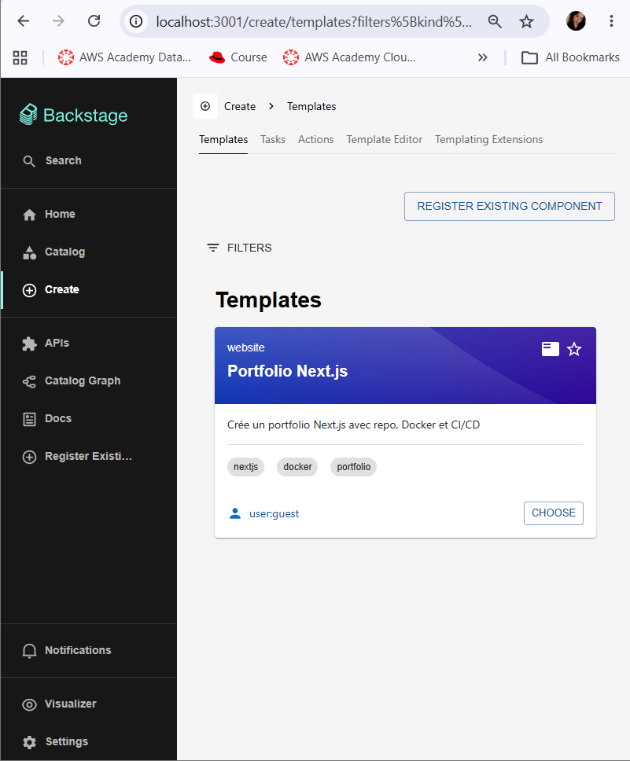
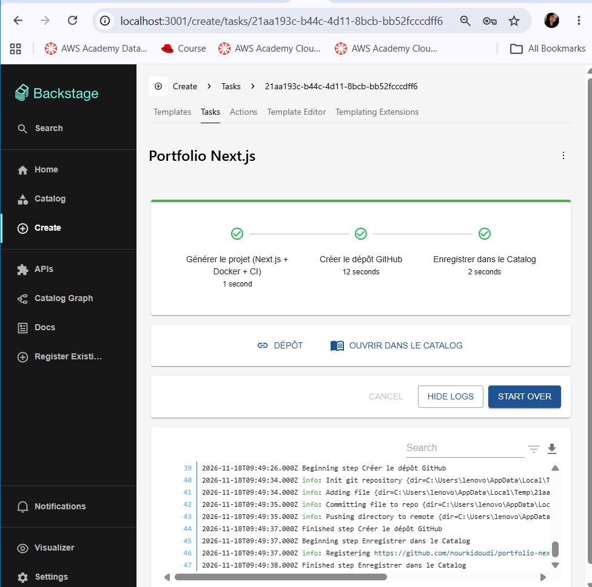
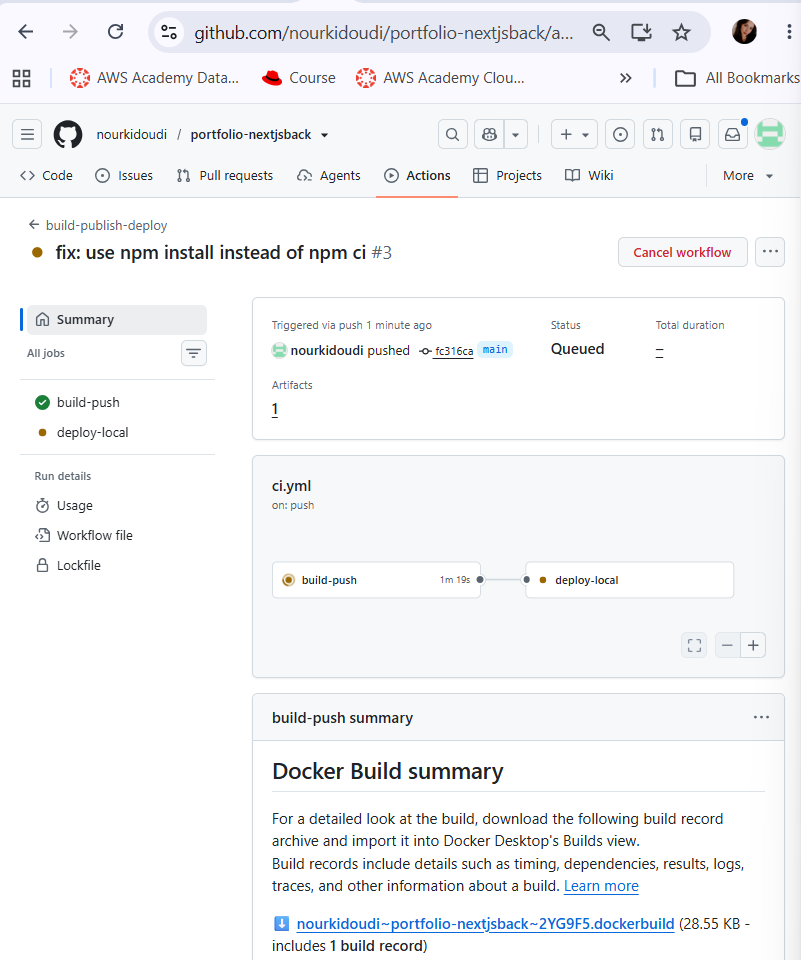
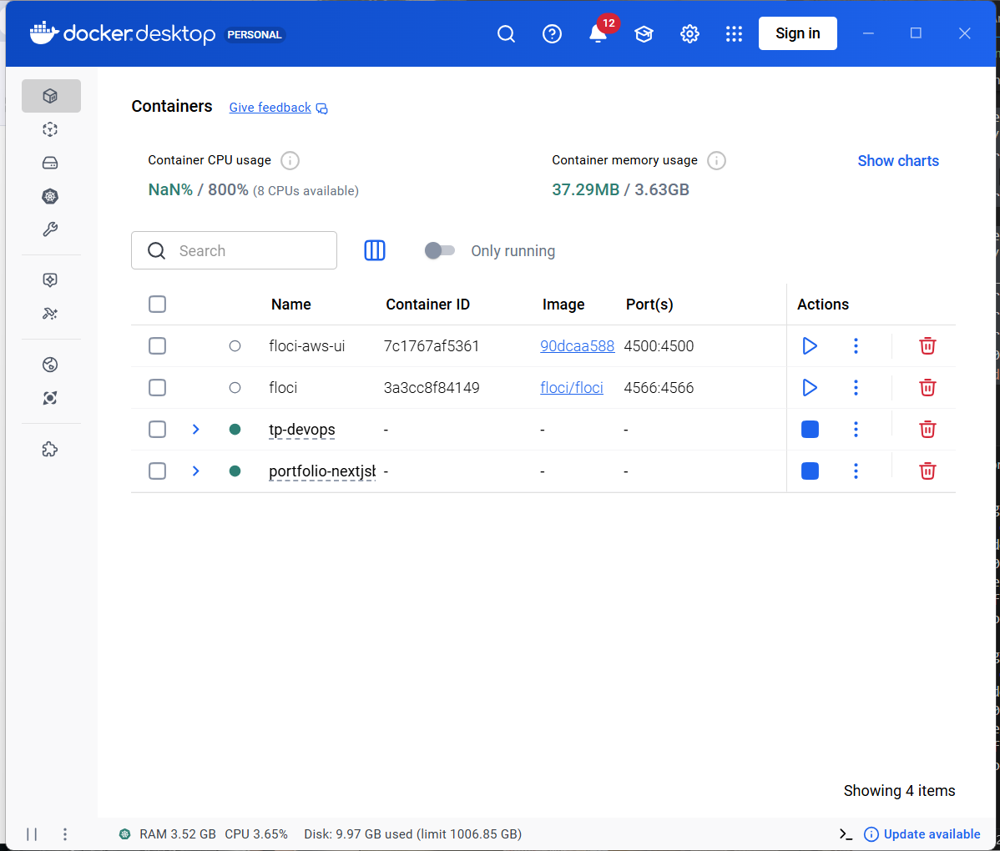
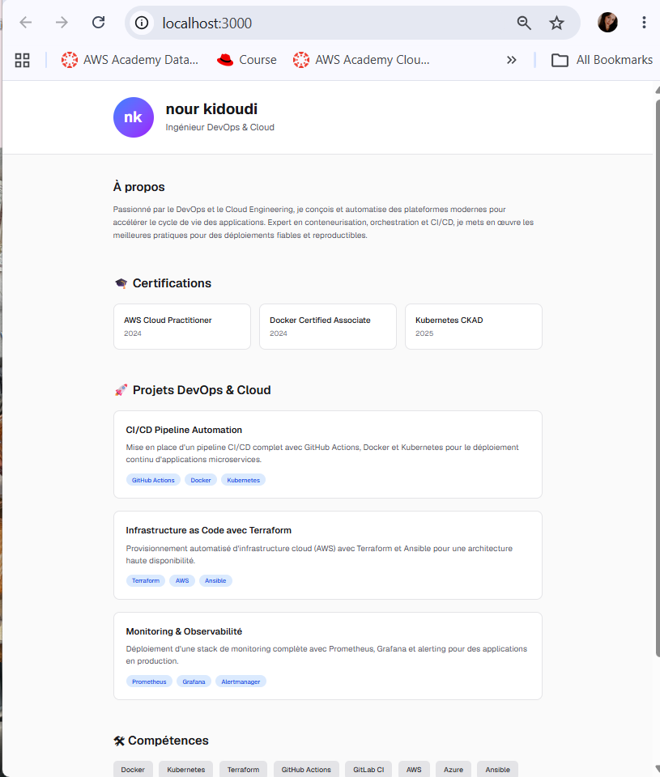

# portfolio-nextjs

> Portfolio de **nour kidoudi** — généré et orchestré automatiquement via [Backstage](https://backstage.io).

---

## 🚀 Stack technique

| Couche | Technologie |
|--------|------------|
| **Portail Développeur** | Backstage (Software Template & Catalog) |
| **Frontend** | Next.js 16 (App Router) + Tailwind CSS |
| **Conteneurisation** | Docker (multi-stage build) |
| **CI/CD** | GitHub Actions (`build-publish-deploy`) |
| **Registry** | Docker Hub (`nourki2003/portfolio-nextjs`) |
| **Orchestration Locale** | docker-compose |

---

## 📸 Démonstration du Cycle de Vie (Captures d'écran)

### 1. Sélection du Software Template Backstage
Le template `portfolio-nextjs-template` permet au développeur de créer un nouveau projet sans exécuter de commande manuelle :


### 2. Exécution et Orchestration Backstage
Backstage génère automatiquement le code, initialise le dépôt Git distant et enregistre le composant dans le catalogue logiciel :


### 3. Pipeline CI/CD & Publication Docker Hub
À chaque push ou déclenchement, GitHub Actions compile l'application, construit l'image Docker multi-stage et la publie avec ses tags versionnés sur Docker Hub :


### 4. Conteneurisation & Déploiement Local (Docker Desktop)
L'application s'exécute dans un conteneur Docker orchestré avec Docker Compose :


### 5. Application Portfolio Next.js Déployée
Le portfolio moderne est accessible localement sur `http://localhost:3000` :


---

## 📦 Démarrage rapide

### Développement local

```bash
npm install
npm run dev
```

Ouvrir [http://localhost:3000](http://localhost:3000).

### Avec Docker

```bash
docker compose up -d
```

L'application est accessible sur [http://localhost:3000](http://localhost:3000).

---

## 🔄 Pipeline CI/CD

Le pipeline GitHub Actions (`build-publish-deploy`) s'exécute automatiquement à chaque `push` sur `main` :

1. **Build** — Construction de l'image Docker multi-stage
2. **Push** — Publication vers Docker Hub avec tag versionné (`v1`, `v2`, etc.) + `latest`
3. **Deploy** — Déploiement local via `docker compose`

Vous pouvez aussi déclencher le pipeline manuellement avec un numéro de version personnalisé via `workflow_dispatch`.

---

## 📂 Structure du projet

```
├── app/
│   ├── page.tsx          # Page principale du portfolio
│   ├── layout.tsx         # Layout racine
│   └── globals.css        # Styles globaux (Tailwind CSS)
├── public/                # Assets statiques
├── captures/              # Captures d'écran du cycle de vie
├── Dockerfile             # Build multi-stage optimisé
├── docker-compose.yml     # Déploiement local
├── .github/workflows/
│   └── ci.yml             # Pipeline CI/CD
├── catalog-info.yaml      # Métadonnées Backstage Catalog
├── postcss.config.mjs     # Configuration PostCSS
└── package.json
```

---

## 🏗 Industrialisation avec Backstage

Ce projet a été créé via le template **portfolio-nextjs-template** dans Backstage, qui automatise :

- La génération du code Next.js
- La création du dépôt GitHub
- La configuration Docker (Dockerfile, .dockerignore, docker-compose.yml)
- Le pipeline CI/CD (GitHub Actions)
- L'enregistrement dans le catalogue Backstage
